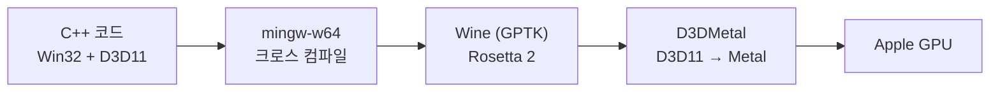

<div align="center">

# RastertekSample

[Rastertek DirectX 11 튜토리얼](https://rastertek.com/tutdx11win10.html)을 따라가며 공부하는 저장소입니다.<br>
윈도우와 맥(Apple Silicon) 양쪽에서 같은 코드로 빌드하고 디버깅합니다.


</div>

<!-- 스크린샷: docs/images/ 에 이미지를 넣고 이 주석을 해제하면 됩니다
<p align="center">
  
  
  
  
</p>
-->

## 진행 상황

현재 튜토리얼 11까지 진행했습니다.

| # | 튜토리얼 | 내용 |
|:-:|---|---|
| 02 | 프레임워크와 창 생성 | Win32 창, 메시지 루프, System / Input / Application 클래스 |
| 03 | DirectX 11 초기화 | 디바이스, 스왑 체인, 렌더 타깃, 뎁스 스텐실 버퍼 |
| 04 | 버퍼, 셰이더, HLSL | 정점 버퍼, 인덱스 버퍼, 입력 레이아웃, 상수 버퍼 |
| 05 | 텍스처 | TGA 로드, 셰이더 리소스 뷰, 샘플러 |
| 06 | 디퓨즈 라이팅 | 법선과 빛 방향의 내적으로 밝기 계산 (램버트) |
| 07 | 3D 모델 렌더링 | 모델 파일에서 위치, UV, 법선 읽기 |
| 08 | 이동, 회전, 스케일 | 월드 행렬 조합 |
| 09 | 앰비언트 라이팅 | 환경광 추가 |
| 10 | 스페큘러 라이팅 | 반사 벡터와 시선 방향으로 하이라이트 계산 |
| 11 | 다중 점광원 | 점광원 4개를 상수 버퍼 배열로 넘기고 셰이더에서 루프로 합산 |

## 맥에서 개발하기

Metal로 포팅하지 않고, 윈도우용 exe를 맥에서 그대로 실행하는 방식입니다. 코드에 플랫폼 분기가 없고 브랜치도 `master` 하나만 사용합니다.



| 작업 | 방법 |
|---|---|
| 빌드, 실행 | `scripts/mac-build.sh`, `scripts/mac-run.sh` 또는 Rider/CLion 실행 구성 |
| 브레이크포인트 디버깅 | `scripts/mac-debug.sh` 실행 후 CLion Remote Debug로 접속 |
| GPU 프레임 캡처 | `MTL_CAPTURE_ENABLED=1`로 실행 후 Xcode Metal Debugger로 열기 |
| 윈도우 빌드 확인 | 같은 코드를 Visual Studio에서 빌드 |

### 디버깅 환경

처음에는 Wine에 들어 있는 `winedbg`를 사용했는데, 이 방식은 D3DMetal이 없는 Wine에서만 동작해서 D3D 초기화가 실패했습니다. 로직은 디버깅할 수 있어도 렌더링 코드는 확인할 수 없는 상태였습니다.

그래서 MSYS2의 `gdbserver.exe`를 GPTK 안에서 앱과 같이 띄우고, 맥에 설치한 gdb로 원격 접속하는 방식으로 바꿨습니다. `gdbserver.exe`는 일반 윈도우 프로그램이라 GPTK에서 문제없이 돌고, 맥 쪽 gdb는 TCP로 붙기만 하면 되기 때문에 Rosetta나 arm64 문제도 없습니다. CLion Remote Debug 구성까지 연결해서 지금은 화면이 그려지는 상태로 렌더 루프에 브레이크포인트를 걸고 변수와 콜스택을 확인할 수 있습니다.

설치와 디버깅 과정은 아래 문서에 정리했습니다.

- [macOS 개발 환경 설정](docs/MAC_SETUP.md)
- [macOS 디버깅 방법 비교](docs/MAC_DEBUGGING.md)

## 빌드

### Windows

`RastertekSample.sln`을 Visual Studio로 열고 실행합니다.

### macOS

```sh
brew install cmake ninja mingw-w64
brew trust gcenx/wine && brew install --cask game-porting-toolkit

./scripts/mac-build.sh   # build-mac/RastertekSample.exe 생성
./scripts/mac-run.sh     # Wine(GPTK)으로 실행
```

Rider나 CLion에서는 폴더를 열고 CMake 프리셋 `macOS mingw (Debug)`를 선택하면 됩니다.

새 소스 파일을 추가할 때는 `.vcxproj`와 `CMakeLists.txt` 양쪽에 등록해야 합니다.

<details>
<summary><b>폴더 구조</b></summary>

```
main.cpp                 WinMain 진입점
Framework/
  Core/                  System, Input, Application (창, 메시지 루프, 프레임 루프)
  Graphics/              D3D, Camera, Model, Texture, Light
  Shaders/               Color, Texture, Light 셰이더 클래스
assets/
  shaders/               HLSL 소스 (.vs / .ps, 런타임 컴파일)
  models/                cube, plane, sphere
  textures/
docs/                    macOS 설정, 디버깅 문서
scripts/, cmake/         macOS 크로스 컴파일 툴체인, 실행 스크립트
external/DirectXMath/    mingw 빌드용 DirectXMath
```

</details>
